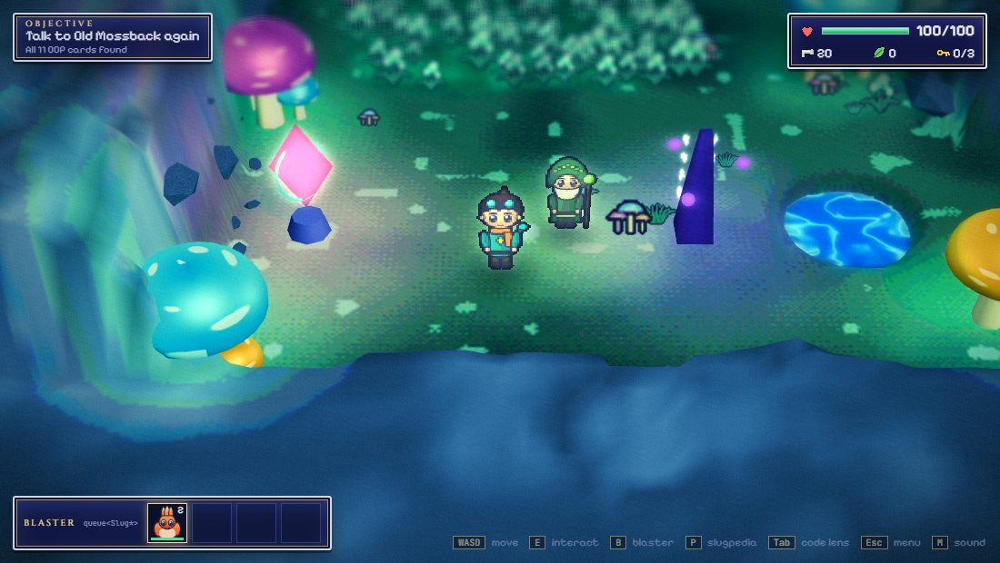
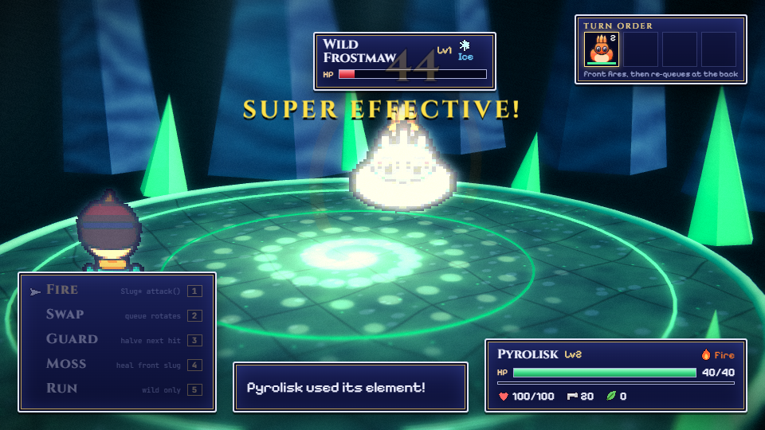
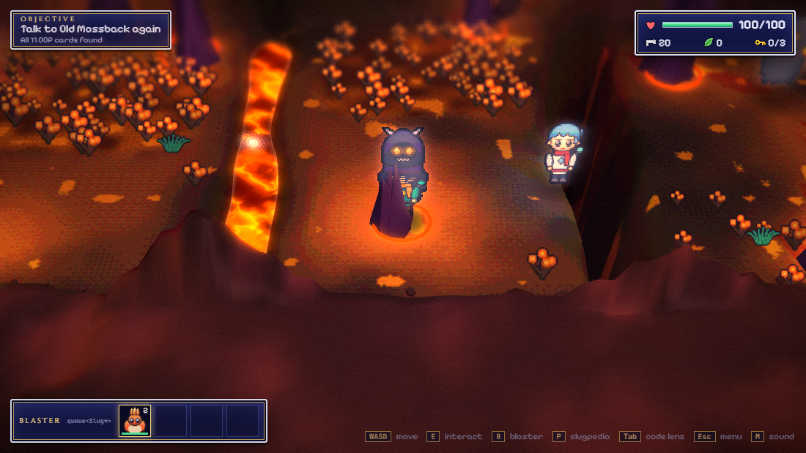
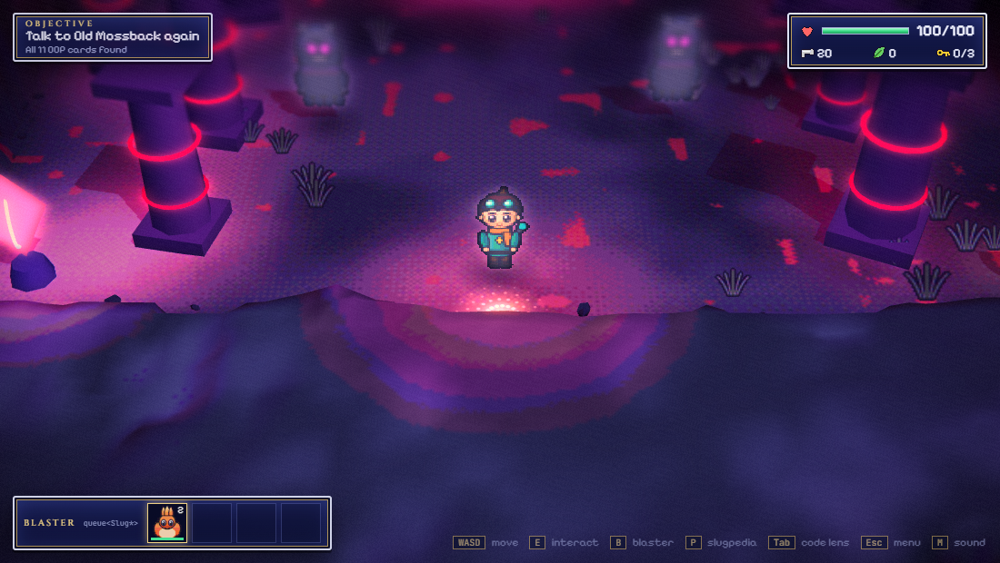
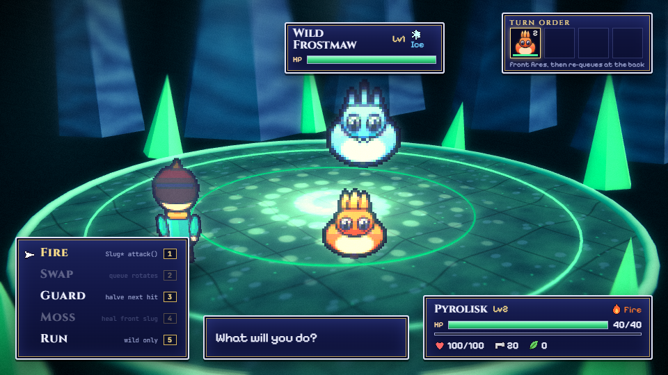
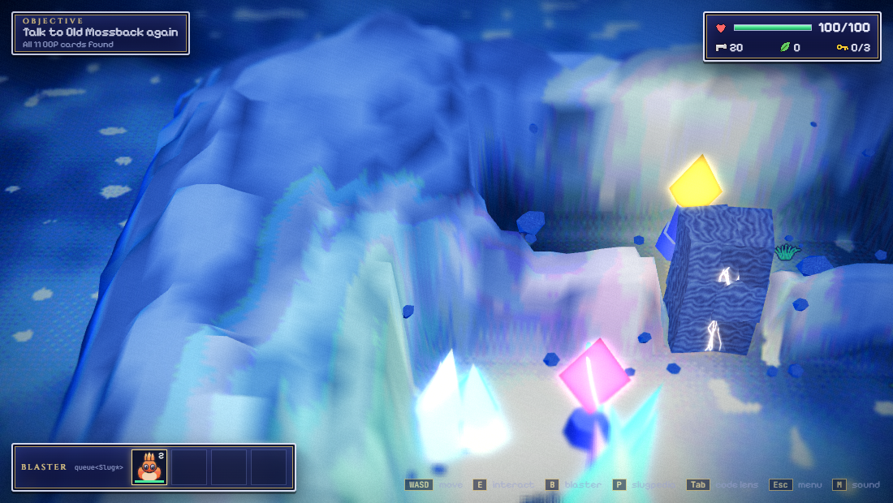
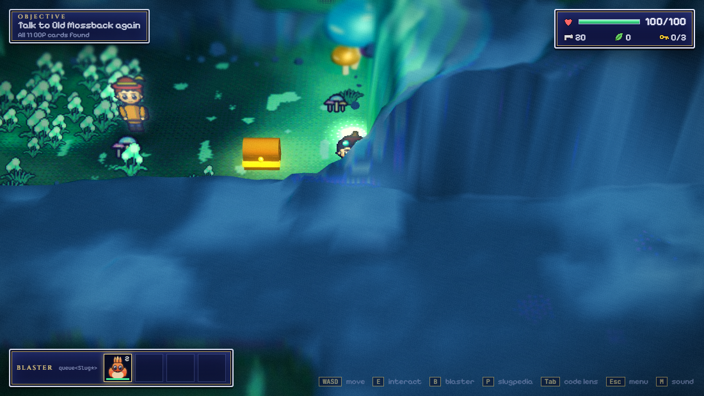
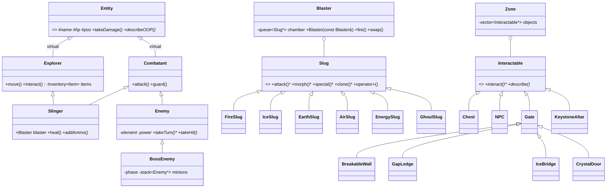

# SLUGBOUND

*Explore the dark. Load your slugs. Take back the light.*

[](https://slugbound.vercel.app/)
[](https://github.com/siddhu2606/slugbound/actions/workflows/deploy.yml)


A 2.5D **HD-2D** exploration-and-duel game for the Object Oriented Programming course (C++). A **C++ engine** runs every rule.
A **Babylon.js** frontend draws it: real 3D terrain, lit and shadowed sprites, toon-shaded 3D slugs, fog, coloured lights, glow and tilt-shift.
Every system in the game exists to demonstrate an OOP concept, and the game **teaches the concept live** through OOP Cards and a Code Lens.

### 🎮 Play it now: **https://slugbound.vercel.app/**

No install and no account. It runs in your browser, and your progress is saved in your browser.

| | |
|---|---|
|  |  |
|  |  |

<details>
<summary>More screenshots, and the look before the HD-2D rework</summary>

| | |
|---|---|
|  |  |
|  | |

Before the rework: [grotto](docs/screens/before_grotto.png), [battle](docs/screens/before_battle.png), [OOP card](docs/screens/before_card.png), [Code Lens](docs/screens/before_lens.png).

</details>

## Contents

[The game](#the-game) · [Controls](#controls) · [Tech stack](#tech-stack) · [How it works](#how-it-works) · [Run it locally](#run-it-locally) · [Tests and CI](#tests-and-ci) · [Deploy](#deploy) · [Troubleshooting](#troubleshooting) · [The look: HD-2D](#the-look-hd-2d) · [OOP concepts](#where-each-oop-concept-lives) · [Project layout](#project-layout) · [UML](#class-hierarchy-uml) · [API](#api-routes) · [Credits](#credits)

## The game

* **4 zones:** Glowmoss Grotto (tutorial), Crystal Hollows, Magma Vein, Gorvax's Keep. About 12 to 15 minutes.
* **6 slugs:** Pyrolisk (Fire), Frostmaw (Ice), Boulderback (Earth), Zephyra (Air), Voltick (Energy), Umbrafang (Ghoul, **fusion only**).
* **Element wheel:** Fire → Ice → Air → Earth → Energy → Fire. Next element = **2x**, previous = **0.5x**.
* **Blaster = a queue.** The front slug fires, then re-queues at the back. Slugs that faint leave the blaster.
* **Ability gates:** the slug that opens a gate must be *in your blaster*. Earth smashes walls, Ice freezes lava and water, Air glides across chasms, Energy powers crystal doors. The wrong loadout means a locked gate.
* **Boss, Gorvax:** phase 1 shield element rotates every 2 turns. Phase 2 summons a *stack* of minions (top one absorbs each hit). Phase 3 telegraphs a mega attack: guard or lose half your HP.
* **11 OOP Cards** pop up as you play (tutorial in the Grotto). Each card is produced by the class itself through a virtual `describeOOP()`.

## Controls

| Key | Action |
|---|---|
| `WASD` / arrows | walk |
| `E` / `Space` | talk, open, interact |
| `B` | blaster: load up to 4 slugs, FRONT fires first |
| `P` | Slugpedia |
| `Tab` | **Code Lens**: class tags over every object + live console of `[ctor] [dtor] [call] [throw] [catch]` |
| `Esc` | menu: save, load, quality (Low / Medium / High), sound |
| `1`-`5` | in a duel: fire, swap, guard, moss, run |

Tip: if the game feels slow, press `Esc` and set quality to **Low** or **Medium**.

## Tech stack

| Layer | What | Notes |
|---|---|---|
| Game logic | **C++17**, no external libraries | Every rule, object, battle and save lives here |
| In the browser | C++ compiled to **WebAssembly** with Emscripten 3.1.64 | Same source as the native build |
| Rendering | **Babylon.js** (vendored in `web/vendor/`) | Plain JavaScript, no bundler, no npm |
| Local server | [cpp-httplib](https://github.com/yhirose/cpp-httplib) (single header) | Native build only |
| Fonts | Cinzel, Pixelify Sans, JetBrains Mono (Google Fonts) | |
| Art and sound | Generated in code (canvas, procedural textures, WebAudio) | No asset files |
| Hosting | **Vercel** (static site). Render and GitHub Pages also work | See [Deploy](#deploy) |

## How it works

```
┌──────────────────────┐   JSON in / JSON out   ┌───────────────────────┐
│  Browser (Babylon)   │ ─────────────────────► │   C++ engine          │
│  draws, animates,    │                        │   all rules, objects, │
│  plays sound         │ ◄───────────────────── │   battles, saves      │
└──────────────────────┘  "40 dmg, super eff."  └───────────────────────┘
```

* **The frontend never decides anything.** It sends player input (`/move`, `/fire`, ...) and animates what C++ answers.
* The same engine runs in **three ways**, all through the single entry point `GameEngine::handle(route, json)`:

| Mode | How | Saves go to |
|---|---|---|
| **Hosted (WebAssembly)** | Engine compiled to `web/engine/engine.js` + `.wasm`, runs inside the browser tab | the browser's `localStorage` (one private game per player) |
| **Native server** | `server/main_server.cpp` serves `web/` and answers `/api/...` | `slugbound.sav` file next to the server |
| **Console** | `console/main_console.cpp`, a text game | `slugbound.sav` file |

* Because the hosted game runs entirely in the player's browser, **there is no backend to keep alive**, and two people playing at once never share a game. The native server holds a single game in memory, so it is meant for local use only.
* If the WebAssembly engine ever crashes, `web/js/api.js` starts a fresh one from your last save.

## Run it locally

You only need a C++17 compiler (`g++` or `clang++`). The browser part needs no install.

**Linux / macOS / Git Bash / WSL**

```bash
git clone https://github.com/siddhu2606/slugbound.git
cd slugbound
bash build.sh test      # C++ unit tests (diamond, deep copy, fusion, unwinding, saves, boss stack ...)
bash build.sh play      # native engine + web page on http://localhost:8080
```

Then open **http://localhost:8080/index.html?server**. The `?server` part tells the page to talk to the native server instead of looking for the WebAssembly build.

| Command | What it does |
|---|---|
| `bash build.sh test` | build and run the C++ unit tests |
| `bash build.sh play` | native server + web page on port 8080 |
| `bash build.sh console` | play in the terminal: type `/state`, `/move {"dir":"up"}` |
| `bash build.sh bot` | a bot plays the whole game through the API (needs `play` running in another terminal) |
| `bash build.sh wasm` | compile the engine to WebAssembly into `web/engine/` (needs [Emscripten](https://emscripten.org/docs/getting_started/downloads.html)) |
| `bash build.sh hosted` | what Vercel and Render run: installs Emscripten if missing, builds WASM, stamps cache-busting (aliases: `render`, `vercel`) |

<details>
<summary><b>Windows without bash (plain PowerShell)</b></summary>

`build.sh` needs bash (install [Git for Windows](https://git-scm.com/download/win) and use **Git Bash**), or you can call the compiler yourself. You need `g++` from [MSYS2](https://www.msys2.org/).

```powershell
mkdir build -Force
# run the tests
g++ -std=c++17 -O1 -static -o build/tests.exe tests/test_engine.cpp (Get-ChildItem engine\*.cpp).FullName
cd build; .\tests.exe; cd ..
# play
g++ -std=c++17 -O1 -static -o build/server.exe server/main_server.cpp (Get-ChildItem engine\*.cpp).FullName -lws2_32 -lpthread
.\build\server.exe 8080 web
```

Then open http://localhost:8080/index.html?server

</details>

**Developer switches**

* `SLUG_SEED=7` (environment variable) gives a fixed random seed, so a run is repeatable. CI uses this.
* `./build/server 8080 web --debug` turns on dev-only routes for testing.
* Use another port with `./build/server 9000 web` if 8080 is busy.

## Tests and CI

* `tests/test_engine.cpp` covers the OOP-heavy parts: the virtual-inheritance diamond, deep copy of the blaster, slug fusion, stack unwinding, binary saves (including corrupted and truncated files) and the boss minion stack.
* `tools/bot.js` plays the **whole game** through the API, from the Grotto to Gorvax's defeat, and fails if anything breaks.
* [`.github/workflows/deploy.yml`](.github/workflows/deploy.yml) runs on every push to `main`:
  1. **test**: unit tests with AddressSanitizer and UBSan, then the native server plus the bot.
  2. **build**: compiles the engine to WebAssembly with Emscripten.
  3. **deploy**: publishes to GitHub Pages (only works if Pages is enabled: Settings → Pages → Source: GitHub Actions).

## Deploy

The hosted site is just static files: `web/` plus the WebAssembly engine that gets built at deploy time. `web/engine/` is in `.gitignore` because it is a build output.

### Vercel (what the live site uses)

1. Import the repo at [vercel.com/new](https://vercel.com/new).
2. Leave everything as it is. Settings come from [`vercel.json`](vercel.json):
   * Build command: `bash build.sh vercel`
   * Output directory: `web`
   * Install command: `echo skip`
3. Click **Deploy**. The first build takes several minutes because it downloads Emscripten. Every push to `main` redeploys.

### Render (alternative)

**New → Blueprint**, pick the repo. It reads [`render.yaml`](render.yaml) (static site, build command `bash build.sh render`, publish directory `web`).
No start command is needed.

### What the hosted build does

`build.sh hosted` (1) installs Emscripten 3.1.64 if `em++` is missing, (2) compiles `engine/*.cpp` to `web/engine/engine.js` + `.wasm`, (3) adds `?v=<commit>` to the scripts and stylesheet in `index.html` so browsers never show an old version, and (4) removes dev-only pages. Files in `/js/` and `/engine/` are served with `Cache-Control: no-cache`. No environment variables are needed.

## Troubleshooting

| Problem | Fix |
|---|---|
| `bash : The term 'bash' is not recognized` (Windows) | Use Git Bash, or the PowerShell commands in [Run it locally](#run-it-locally) |
| Blank page when opening `web/index.html` by double-click | Don't. It needs a server. Run `bash build.sh play` and open the `localhost` link |
| `localhost` page loads but the game says it cannot answer | Add `?server` to the URL: `http://localhost:8080/index.html?server` |
| Want to start over | In the game press `Esc` and choose New game, or clear the site's data. The save key is `slugbound.save.v1` in `localStorage` |
| Game is laggy | `Esc` → quality → Low |
| Vercel/Render build fails | Open the build log and look at the first error, usually in the Emscripten install or compile step |

## The look: HD-2D

The frontend was rebuilt to read like an HD-2D (Octopath Traveler style) scene: **pixel-art sprites standing in a lit, blurred-edged 3D diorama**.

* **One continuous landscape.** The engine's ASCII tile grid is *logic only*. `web/js/terrain.js` samples it into scalar fields (rock, lava, water, chasm, moss), warps them with noise, blurs them, and builds **one smooth heightfield mesh** (terraced cliffs, sloped banks) plus **one baked ground texture** (dirt / moss / wet stone / crystal dust / strata rock blended with ordered dithering, ambient occlusion in corners, and light bounce from crystals and lava). No tile edge, seam or rectangular pit is ever drawn, and the map is surrounded by cliffs and decorative ground that fade into fog. Collision stays exactly as C++ says.
* **Water and lava** are alpha-masked surfaces cut by the same smooth fields, so the shoreline is irregular, with foam or a glowing rim and gently scrolling flow.
* **Pixel sprites.** Characters, enemies and slugs are painted procedurally, then reduced to real pixel art (hard alpha, small palette, 1px outline, nearest-neighbour filtering). The player has 4-direction walk frames. Sprites receive light and cast shadows on the ground.
* **Camera and post-FX:** narrow field of view, look-ahead and soft bounds; tilt-shift depth of field (sharp band, blurred top and bottom), glow/bloom on emissives, light shafts, split-tone colour grade (warm highlights, teal shadows), vignette, film grain and edge-only chromatic aberration. All of it scales with the Low / Medium / High setting.
* **UI:** JRPG windows (indigo gradient, thin light-and-gold double border, square corners), Cinzel and Pixelify Sans fonts, pixel-art icons instead of emoji, a hand cursor, an Octopath-style battle layout (command list, turn-order strip, floating enemy plate that reveals weaknesses when you hit them, outlined damage numbers, iris wipe into battle, hit-stop on impacts).
* **Art licence:** everything is generated in code. No third-party or copyrighted assets.

Notes: the colour grade is a procedural split-tone (no LUT image). Sprites face the camera as billboards (no extra lean).

## Where each OOP concept lives

| Concept | Where | Why it is built that way |
|---|---|---|
| **Virtual inheritance, the diamond** | `engine/entities.h`, `engine/slinger.h`: `Entity` ← `Combatant`, `Explorer` ← `Slinger` | A Slinger fights *and* explores. `virtual public Entity` gives it ONE `hp`. `Slinger`'s constructor builds `Entity` itself. |
| Single / multilevel / hierarchical inheritance | `Slug` → five elements; `Entity` → `Combatant` → `Enemy` → `BossEnemy` | `engine/slugs.h`, `engine/enemy.h` |
| **Abstract classes, pure virtual** | `Slug` (`attack`, `morph`, `special`, `clone`, `describeOOP`), `Interactable` (`interact`, `describe`) | The battle never says `if (element == FIRE)`. A new slug is a new subclass. |
| **Polymorphism, virtual dispatch** | `Battle::fire()` calls `slug->attack(enemy)` on a `Slug*`; `Battle::enemyTurn()` calls `enemy->takeTurn()` | `engine/battle.cpp` |
| **Virtual destructors** | `delete` on a `Slug*` / `Enemy*` prints `[dtor] FireSlug` then `[dtor] Slug` | Visible in the Code Lens console |
| **Up / downcasting** | `Zone` stores `Interactable*`; `dynamic_cast<BreakableWall*>` in `Zone::interact`; `Explorer::interact` downcasts to `Slinger*` | `engine/world.cpp` |
| **Copy constructor, deep copy, `clone()`** | `Blaster(const Blaster&)` clones every `Slug*`. A `Battle` snapshots your blaster and restores it if you black out. | `engine/slugs.cpp`, `engine/battle.cpp` |
| **Templates** | `Inventory<T>` (`Slug*`, `Item`, `Keystone`), `Registry<T>` (`Zone*`), `clampValue<T>`, `findMax<T>` | `engine/templates.h` |
| **Operator overloading** | `Slug + Slug` = fusion (returns `new GhoulSlug`), `>`, `==`, `++`, `+=`, `<<`, `>>` (reads the Slugpedia text) | `engine/slugs.cpp` |
| **STL** | `queue` blaster and turn order, `stack` boss minions, `map` + `set` Slugpedia, `vector<Interactable*>` zones, `list` battle log, `sort`/lambdas | each chosen for its access pattern |
| **Exceptions and stack unwinding** | `GameException` hierarchy. `Gate::interact` throws `GateLockedException`; two `ScopedLogger` locals print `[dtor]` in reverse order before `[catch]` | try it: walk into the chasm with no Air slug |
| **Binary file handling** | `SaveManager`: magic number, version, fields one by one, a type tag per slug and `Slug::fromFile()` for polymorphic loading. Short or bad files throw `SaveCorruptedException`. | `engine/save.cpp` |
| `friend`, `static`, overloading, `this`-chaining, `const` | `DamageCalculator` (friend, `static calcCount`), `Slug::totalSlugs`, `attack(e)` / `attack(e, boost)`, `heal(10).addAmmo(2)` | |

### Viva one-liners

* *Virtual inheritance makes `Combatant` and `Explorer` share one `Entity`, so `Slinger` has one `hp`, not two. The most derived class initialises the virtual base.*
* *A pure virtual function makes `Slug` abstract, so every element must override `attack()`. The compiler enforces that.*
* *I serialise field by field with a type tag, because `Slug*` is polymorphic and a raw `sizeof` write would store a vtable pointer.*
* *When an exception is thrown, C++ destroys every local between the `throw` and the `catch`, in reverse order. Our console shows that order.*

More questions and answers are in [docs/DESIGN.md](docs/DESIGN.md#10-viva-prep). The full design (story, gameplay, UML, teaching layer, architecture) is in [docs/DESIGN.md](docs/DESIGN.md).

## Project layout

```
engine/    the C++ game (graded part): one small file per area
  common.h/.cpp      elements, positions, Logger, exceptions, JSON helpers
  templates.h        Inventory<T>, Registry<T>, clampValue<T>, findMax<T>
  entities.h/.cpp    Entity (virtual base), Combatant, Explorer
  slugs.h/.cpp       Slug hierarchy, Blaster, Slugpedia, operators
  enemy.h/.cpp       Enemy, BossEnemy, DamageCalculator (friend)
  slinger.h/.cpp     Slinger (the diamond)
  world.h/.cpp       Interactable family, Zone, WorldMap, the four maps
  battle.h/.cpp      the duel
  save.h/.cpp        binary saves
  game.h/.cpp        GameEngine::handle(route, json), the one entry point
server/    native HTTP server (cpp-httplib)
console/   text-mode game
wasm/      WebAssembly entry point
tests/     C++ unit tests
tools/     bot that plays the whole game, plus art patch scripts
web/       Babylon.js frontend
  index.html, css/style.css
  js/api.js       talks to the engine (WebAssembly or HTTP)
  js/terrain.js   builds the 3D landscape from the engine's tile grid
  js/scene.js     the 3D world, lights, camera, post-FX
  js/art.js, art2.js, slugs3d.js   procedural sprites and 3D slugs
  js/battle.js, ui.js, game.js     duel screen, menus, main loop
  js/audio.js     WebAudio music and effects
  vendor/babylon.js
docs/      design document, UML and screenshots
build.sh   test / play / console / bot / wasm / hosted
vercel.json, render.yaml, .github/workflows/deploy.yml   deployment
```

## Class hierarchy (UML)



## API routes

The browser talks to the engine with these routes, either as direct WebAssembly calls or as `POST /api/...` to the native server.

| Route | Purpose |
|---|---|
| `GET /zone` | Layout and objects to draw |
| `POST /move` | Direction in, validated position and any event out |
| `POST /interact` | Calls `interact()` on the object in front of you |
| `GET /slugs` | Your collection |
| `POST /loadout` | Set the 4 blaster slugs |
| `POST /fire`, `/swap`, `/guard` | Player combat actions |
| `POST /enemyturn` | Enemy move |
| `GET /inspect?id=` | Returns that object's `describeOOP()` |
| `POST /save`, `GET /load` | Binary save and load |

## How it differs from the plan

* The hosted game runs the C++ engine as **WebAssembly in the browser** (no server to keep alive). The native HTTP server is still there for local runs.
* The world container is called `WorldMap` (a class named `World` inside `namespace World` would be confusing).
* All art is **painted in code** (canvas sprites, procedural textures, geometry built from the zone layout, WebAudio music), so there are no image or sound files to license. 3D models are built from primitives with a toon shader and inked outlines.
* A fainted slug stays in storage until healed; the `[dtor]` lines come from releasing slugs, fusing, and from every duel (the `Battle` deletes its `Enemy*` and its backup `Blaster`).

## Credits

Original world and creatures (Slugterra-*inspired* only in spirit). [Babylon.js](https://www.babylonjs.com/) for rendering, [cpp-httplib](https://github.com/yhirose/cpp-httplib) for the local server, and [Emscripten](https://emscripten.org/) for the WebAssembly build.